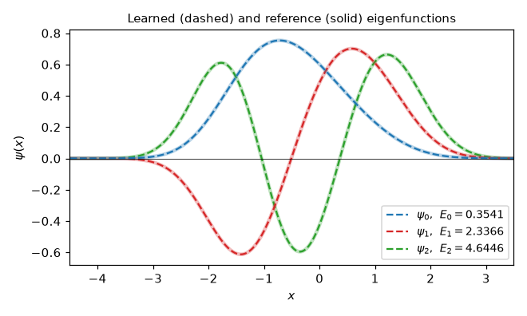

Sturm-Liouville eigenvalue problem
==================================

Problem setup
-------------

We look for the three lowest eigenvalues :math:`E_0 < E_1 < E_2` and their eigenfunctions :math:`\psi_0, \psi_1, \psi_2` of the Sturm-Liouville problem

.. math:: -\psi''(x) + V(x)\psi(x) = E\psi(x), \qquad V(x) = \frac{x^4}{4} + x,

for :math:`x \in [-4.5, 3.5]`, with boundary conditions

.. math:: \psi(-4.5) = \psi(3.5) = 0.

There is no known closed-form solution. As reference values, the example computes the eigenvalues by Chebyshev collocation, accurate to about 11 digits:

.. math:: E_0 = 0.3541232627, \quad E_1 = 2.3366342281, \quad E_2 = 4.6446047900.

The interval is chosen so that the eigenfunctions are already very small at its ends. The potential has its minimum at :math:`x = -1` and grows like :math:`x^4/4`, so the eigenfunctions decay roughly like :math:`e^{-|x|^3/6}` away from the well. As a result, the three eigenvalues differ from those on the whole real line by less than :math:`2 \times 10^{-6}` (relative).

Implementation
--------------

This description goes through the implementation of a solver for the above problem step-by-step.

First, the DeepXDE and NumPy (``np``) modules are imported:

.. code-block:: python

    import deepxde as dde
    import numpy as np

We use double precision. In single precision, L-BFGS stops much earlier here, and the results are less accurate: in a test with seed 0, the relative error of :math:`E_0` grew from :math:`1.9 \times 10^{-5}` to :math:`3.3 \times 10^{-4}`, and that of :math:`E_1` from :math:`8.8 \times 10^{-7}` to :math:`4.6 \times 10^{-5}`.

.. code-block:: python

    dde.config.set_default_float("float64")

The eigenvalues are unknown, so we make them trainable variables with initial guess 0, which is below the lowest eigenvalue. They are learned together with the network, in the same way as the unknown parameters in the inverse problem for the Lorenz system.

.. code-block:: python

    K = 3
    a, b = -4.5, 3.5

    def V(x):
        return x**4 / 4 + x

    E = [dde.Variable(0.0) for _ in range(K)]

One network with :math:`K` outputs represents the :math:`K` eigenfunctions. For each output, the residual of the ODE uses its own eigenvalue:

.. code-block:: python

    def pde(x, psi):
        residuals = [
            -dde.grad.hessian(psi, x, component=k) + (V(x) - E[k]) * psi[:, k : k + 1]
            for k in range(K)
        ]

These residuals are zero for the trivial solution :math:`\psi = 0`, and nothing in them stops two outputs from learning the same eigenfunction. Both problems are solved by requiring the eigenfunctions to be orthonormal:

.. math:: \int_a^b \psi_j(x) \psi_k(x) \, dx = \delta_{jk}.

The training points form a uniform grid inside :math:`(a, b)`, and :math:`\psi = 0` at both ends, so the trapezoidal rule for these integrals is :math:`h` times the sum over the points, where :math:`h = (b - a)/(n + 1)` for :math:`n` points. Since the eigenfunctions are tiny near both ends, this rule is very accurate here: for the exact eigenfunctions, the orthonormality conditions hold to about :math:`10^{-14}`. So this loss does not pull the network away from the exact solution. The :math:`K(K+1)/2` conditions are returned as one more residual, repeated at every point:

.. code-block:: python

        h = (b - a) / (len(x) + 1)
        orthonormality = [
            h * dde.backend.reduce_sum(psi[:, j] * psi[:, k]) - float(j == k)
            for j in range(K)
            for k in range(j, K)
        ]
        orthonormality = dde.backend.reshape(dde.backend.stack(orthonormality, 0), [1, -1])
        return residuals + [orthonormality + 0 * x]

The computational geometry is an interval. We use 400 training points on a uniform grid (``train_distribution="uniform"``), which the trapezoidal rule above relies on, and 1000 test points:

.. code-block:: python

    geom = dde.geometry.Interval(a, b)
    data = dde.data.PDE(
        geom, pde, [], num_domain=400, num_test=1000, train_distribution="uniform"
    )

Next, we choose the network. Here, we use a fully connected neural network of depth 4 (i.e., 3 hidden layers), width 32, and :math:`K` outputs:

.. code-block:: python

    net = dde.nn.FNN([1] + [32] * 3 + [K], "tanh", "Glorot normal")

The boundary conditions :math:`\psi(a) = \psi(b) = 0` are imposed exactly, by multiplying the network outputs by :math:`(x - a)(b - x)`, divided by its maximum, 16:

.. code-block:: python

    def output_transform(x, y):
        return (x - a) * (b - x) / 16 * y

    net.apply_output_transform(output_transform)

Now, we have the problem and the network. We build a ``Model`` and pass the eigenvalues as external trainable variables. The orthonormality loss gets a large weight, 1000, so that the outputs stay orthonormal. The callback ``VariableValue`` prints the current eigenvalues every 1000 iterations. We first train with Adam for 10000 iterations at learning rate 0.001, and then with L-BFGS:

.. code-block:: python

    model = dde.Model(data, net)

    variable = dde.callbacks.VariableValue(E, period=1000, precision=6)
    weights = [1] * K + [1000]
    model.compile("adam", lr=0.001, loss_weights=weights, external_trainable_variables=E)
    losshistory, train_state = model.train(iterations=10000, callbacks=[variable])
    model.compile("L-BFGS", loss_weights=weights, external_trainable_variables=E)
    losshistory, train_state = model.train(callbacks=[variable])

The outputs come in no particular order, so we sort them by eigenvalue:

.. code-block:: python

    E_pred = np.array([dde.backend.to_numpy(e) for e in E])
    order = np.argsort(E_pred)

Nothing in the training forces the three learned eigenpairs to be the three lowest; starting all eigenvalues at 0, below the spectrum, makes this likely but does not guarantee it. So we check the result in two ways. First, the eigenvalues are compared with the reference values, computed by Chebyshev collocation in ``reference_eigenvalues`` (see the complete code below). Second, by Sturm's oscillation theorem, the eigenfunction of the :math:`n`-th lowest eigenvalue has exactly :math:`n` zeros inside the interval, and no other eigenfunction has :math:`n` zeros. So if the learned eigenfunctions have 0, 1 and 2 zeros, they are the three lowest, independently of the reference values. We count the sign changes of each learned eigenfunction, ignoring its tails, where it is below 0.1% of its maximum:

.. code-block:: python

    E_ref = reference_eigenvalues()
    x = geom.uniform_points(1000)
    psi = model.predict(x)
    for n, k in enumerate(order):
        p = psi[np.abs(psi[:, k]) > 1e-3 * np.abs(psi[:, k]).max(), k]
        zeros = np.sum(np.sign(p[1:]) != np.sign(p[:-1]))
        error = abs(E_pred[k] - E_ref[n]) / E_ref[n]
        print(
            f"E_{n} = {E_pred[k]:.8f} (reference {E_ref[n]:.8f}), "
            f"relative error {error:.1e}, zeros: {zeros}"
        )

With the PyTorch backend on a CPU and five random seeds (0 to 4, set by ``dde.config.set_random_seed``), every run found the three lowest eigenpairs, and every learned eigenfunction had the right number of zeros. The relative errors of :math:`E_0`, :math:`E_1` and :math:`E_2` were at most :math:`4.3 \times 10^{-5}`, :math:`2.1 \times 10^{-5}` and :math:`6.6 \times 10^{-6}`. Compared with a fine-grid finite-difference solution, the relative :math:`L^2` errors of the eigenfunctions were between :math:`3.3 \times 10^{-5}` and :math:`1.3 \times 10^{-4}`. With 1000 training points instead of 400 (seeds 0 to 2), the errors were of the same size, so the number of points is not what limits the accuracy here. A run takes about 8 minutes on a laptop CPU. The figure shows the eigenfunctions learned with seed 0:

Complete code
-------------

.. literalinclude:: ../../../examples/pinn_forward/Sturm_Liouville.py
  :language: python
