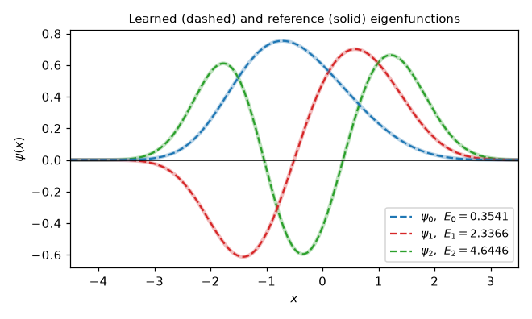

Sturm-Liouville eigenvalue problem
==================================

Problem setup
-------------

We will find the three lowest eigenvalues :math:`E_0 < E_1 < E_2` and their eigenfunctions :math:`\psi_0, \psi_1, \psi_2` of the Sturm-Liouville problem

.. math:: -\psi''(x) + V(x)\psi(x) = E\psi(x), \qquad V(x) = \frac{x^4}{4} + x,

for :math:`x \in [-4.5, 3.5]`, with boundary conditions

.. math:: \psi(-4.5) = \psi(3.5) = 0.

There is no known closed-form solution, but Chebyshev collocation gives the eigenvalues to 12 digits:

.. math:: E_0 = 0.354123262748, \quad E_1 = 2.336634228099, \quad E_2 = 4.644604790037.

The lowest eigenvalue has a physical meaning. On the whole real line, :math:`E_0 = 0.354123244453` is the long-time rate at which the solutions of :math:`dx = x^2 dt + \sqrt{2} dW` escape to infinity, i.e., noise-driven escape past a saddle-node bifurcation. Restricting the problem to :math:`[-4.5, 3.5]` changes it by only :math:`2 \times 10^{-8}`.

Implementation
--------------

This description goes through the implementation of a solver for the above problem step-by-step.

First, the DeepXDE and NumPy (``np``) modules are imported:

.. code-block:: python

    import deepxde as dde
    import numpy as np

We use double precision. In single precision, L-BFGS stops early here, and the eigenvalues are less accurate: in a test, the relative error of :math:`E_0` grew from :math:`1.7 \times 10^{-5}` to :math:`8 \times 10^{-4}`.

.. code-block:: python

    dde.config.set_default_float("float64")

The eigenvalues are unknown, so we make them trainable variables with initial guess 0. They are learned together with the network, in the same way as the unknown parameters in the inverse problem for the Lorenz system.

.. code-block:: python

    K = 3
    E = [dde.Variable(0.0) for _ in range(K)]

One network with :math:`K` outputs represents the :math:`K` eigenfunctions. For each output, the residual of the ODE uses its own eigenvalue:

.. code-block:: python

    def pde(x, psi):
        residuals = [
            -dde.grad.hessian(psi, x, component=k)
            + (x**4 / 4 + x - E[k]) * psi[:, k : k + 1]
            for k in range(K)
        ]

These residuals are zero for the trivial solution :math:`\psi = 0`, and nothing in them stops two outputs from learning the same eigenfunction. Both problems are solved by requiring the eigenfunctions to be orthonormal:

.. math:: \int_a^b \psi_j(x) \psi_k(x) \, dx = \delta_{jk}.

The integrals are approximated by the mean over the points, and the :math:`K(K+1)/2` conditions are returned as one more residual, repeated at every point:

.. code-block:: python

        orthonormality = [
            (b - a) * dde.backend.reduce_mean(psi[:, j] * psi[:, k]) - float(j == k)
            for j in range(K)
            for k in range(j, K)
        ]
        orthonormality = dde.backend.reshape(dde.backend.stack(orthonormality, 0), [1, -1])
        return residuals + [orthonormality + 0 * x]

The computational geometry is an interval, and we use 400 training residual points and 1000 test points:

.. code-block:: python

    a, b = -4.5, 3.5
    geom = dde.geometry.Interval(a, b)
    data = dde.data.PDE(geom, pde, [], num_domain=400, num_test=1000)

Next, we choose the network. Here, we use a fully connected neural network of depth 4 (i.e., 3 hidden layers), width 32, and :math:`K` outputs:

.. code-block:: python

    net = dde.nn.FNN([1] + [32] * 3 + [K], "tanh", "Glorot normal")

The boundary conditions :math:`\psi(a) = \psi(b) = 0` are imposed exactly, by multiplying the network outputs by :math:`(x - a)(b - x)`, divided by its maximum, 16:

.. code-block:: python

    def output_transform(x, y):
        return (x - a) * (b - x) / 16 * y

    net.apply_output_transform(output_transform)

Now, we have the problem and the network. We build a ``Model`` and pass the eigenvalues as external trainable variables. The orthonormality loss gets a large weight, 1000, so that the outputs stay orthonormal. The callback ``VariableValue`` prints the current eigenvalues every 1000 iterations. We first train with Adam for 10000 iterations at learning rate 0.001, and then with L-BFGS:

.. code-block:: python

    model = dde.Model(data, net)

    variable = dde.callbacks.VariableValue(E, period=1000, precision=6)
    weights = [1] * K + [1000]
    model.compile("adam", lr=0.001, loss_weights=weights, external_trainable_variables=E)
    losshistory, train_state = model.train(iterations=10000, callbacks=[variable])
    model.compile("L-BFGS", loss_weights=weights, external_trainable_variables=E)
    losshistory, train_state = model.train(callbacks=[variable])

The outputs come in no particular order, so we sort them by eigenvalue:

.. code-block:: python

    E_pred = np.array([dde.backend.to_numpy(e) for e in E])
    order = np.argsort(E_pred)

Finally, we check the result in two ways. The eigenvalues are compared with the reference values. And by Sturm's oscillation theorem, the :math:`n`-th eigenfunction has exactly :math:`n` zeros inside the interval, so we count the sign changes of each learned eigenfunction, ignoring its tails, where it is below 0.1% of its maximum:

.. code-block:: python

    E_ref = [0.354123262748, 2.336634228099, 4.644604790037]
    x = geom.uniform_points(1000)
    psi = model.predict(x)
    for n, k in enumerate(order):
        p = psi[np.abs(psi[:, k]) > 1e-3 * np.abs(psi[:, k]).max(), k]
        zeros = np.sum(np.sign(p[1:]) != np.sign(p[:-1]))
        error = abs(E_pred[k] - E_ref[n]) / E_ref[n]
        print(f"E_{n} = {E_pred[k]:.8f}, relative error {error:.1e}, zeros: {zeros}")

With the PyTorch backend on a CPU and five random seeds (0 to 4, set by ``dde.config.set_random_seed``), every run found the three lowest eigenpairs, and every learned eigenfunction had the right number of zeros. The relative errors of :math:`E_0`, :math:`E_1` and :math:`E_2` were at most :math:`2.3 \times 10^{-5}`, :math:`1.0 \times 10^{-5}` and :math:`4.4 \times 10^{-6}`. Compared with a fine-grid finite-difference solution, the relative :math:`L^2` errors of the eigenfunctions were between :math:`4 \times 10^{-5}` and :math:`1.4 \times 10^{-4}`. A run takes about five minutes on a laptop CPU. The figure shows the eigenfunctions learned with seed 0:

Note: on Apple silicon, the PyTorch backend runs on the MPS GPU, which does not support float64. Run on the CPU instead, for example with ``torch.set_default_device("cpu")`` after ``import deepxde``.

Complete code
-------------

.. literalinclude:: ../../../examples/pinn_forward/Sturm_Liouville.py
  :language: python
